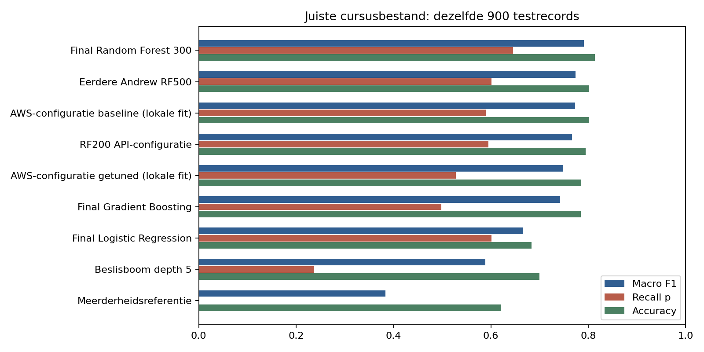
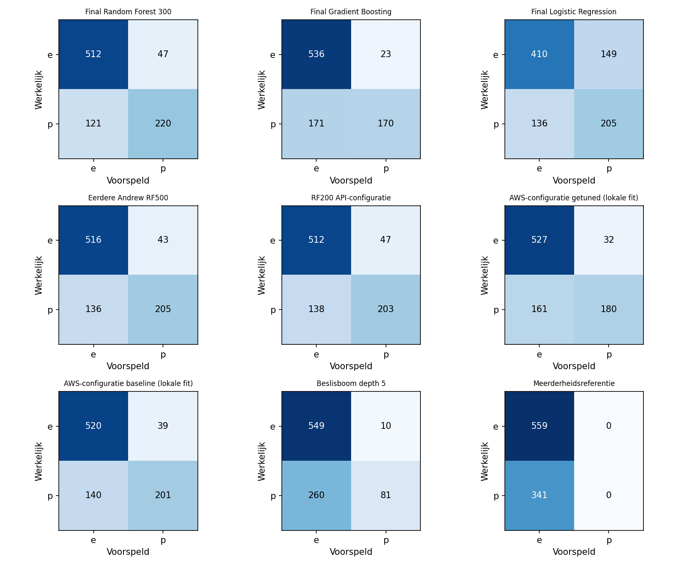

# Definitieve Mushroom-vergelijking — het juiste cursusbestand

**DeepLearningTeam10 · bijgewerkt 14 oktober 2026**

Bijdragen: Andrew Noeyens maakte het finale Mushroom-notebook, de modelkeuzes en
tuning. Jorre Van Dyck maakte de eerdere AWS-run. Codex heeft op verzoek van Jorre
de dataset gecorrigeerd, de gezamenlijke hertraining uitgevoerd, PyCaret gerepareerd
en daadwerkelijk uitgevoerd, en deze vergelijking gemaakt. Het team moet de inhoud
reviewen en zelf kunnen uitleggen. Hiermee is het gebruik van generatieve AI vermeld.

## 1. Besluit en correctie van het eerdere rapport

**Voorlopige keuze op de juiste data: Final Random Forest 300.** Gemiddelde trainings-CV
macro F1 is **0.7619**, met SD 0.0215.
Op de 900 gedeelde testrecords: **81.33% accuracy**, **macro F1
0.7914**, **recall p 64.52%**, **121 FN** en
**47 FP**. De hoogste PyCaret-score is 0.7427
macro F1 bij Random Forest Classifier; dit zijn standaardinstellingen, geen getunede RF300.

De eerdere vergelijking op 61.069 UCI-rijen en de daarop gebaseerde soorten-CV zijn
**vervallen als grondslag voor deze inlevering**. Hun modelkeuze en scores mogen niet
als eindresultaat worden gebruikt. Het geüploade bestand met 5.000 rijen is de bron.
De AWS-score van 100% op UCI zegt niets over deze aangeleverde dataset.

Dit is ontwikkelvalidatie: de testset is in Andrew's notebook al bekeken. De CV-keuze
wordt hier automatisch vastgelegd voordat nieuwe testvoorspellingen worden berekend,
maar de hele onderzoeksprocedure is daardoor niet alsnog geblindeerd.

## 2. Dataset, features en gelijke splits

Bron: [MushroomFinal/mushroom_project_dataset.csv](../MushroomFinal/mushroom_project_dataset.csv),
5.000 rijen, 3.107 `e` en 1.893 `p`, zonder exacte duplicaten. Het CSV-bestand kan met
Excel worden geopend; de repository bevat hiervoor geen afzonderlijk xlsx-bestand.
LF-genormaliseerde SHA-256: `1f1a25f2f330458ed95ce9f6ffe3241582312a42cb21797a2b7bd5e5ad281114`.

`jumbled_noise_0` wordt vóór training verwijderd. **`jumbled_noise_1` blijft behouden**,
zoals in de finale modelcode. De drie numerieke en acht categorische invoervelden zijn:
`cap_diameter, stem_height, stem_width, spore_print_color, gill_color, habitat, season, ring_type, cap_shape, stem_surface, jumbled_noise_1`. Namen gebruiken underscores. De doelkolom
en rij-index worden niet meegegeven als feature. Dezelfde CSV staat ook in de oudere
Andrew-map; het probleem was de overschakeling naar de volledige UCI-download.

Alle handmatige kandidaten en PyCaret gebruiken exact dezelfde 4.100 trainingsrijen
en 900 testrijen: 82/18, gestratificeerd, seed 42. De testset heeft 559 `e` en 341 `p`.
Trainings-CV gebruikt vijf identieke gestratificeerde folds, shuffle en seed 42.
Het manifest bewaart de oorspronkelijke rij, trainingsvolgorde en validatiefold.
Er is geen betrouwbare soort-ID: bronrij delen door 353 zou voor deze aangepaste
dataset ongeldig zijn en wordt niet gedaan.

**Keuzeregel:** gemiddelde CV macro F1; bij exacte gelijkstand CV recall p en vaste
kandidaatvolgorde. Macro F1 weegt beide klassen gelijk. Precision, recall, FN, FP,
balanced accuracy, ROC-AUC en AP blijven zichtbaar. De dummy is alleen een referentie.
Er is geen nieuwe hyperparameter- of drempelkeuze op de testset.

## 3. Welke modellen zijn vergeleken?

| Configuratie | Belangrijkste instellingen en preprocessing |
| --- | --- |
| Final RF300 | Uit finale notebook: 300 bomen, depth 20, max features None, split 4, leaf 1, balanced; mediaan/modus + one-hot |
| Final Gradient Boosting | 200 bomen, learning rate 0,1, depth 3, subsample 0,8; extra proximity-imputatie voor spore_print_color |
| Final Logistic Regression | C=10, L1, liblinear, balanced; proximity-imputatie, mediaan/modus, scaling + one-hot |
| Eerdere RF500 | 500 bomen, depth 20, split 3, balanced; nulmetingen steel → ontbrekend, mediaan/modus + one-hot |
| RF200 API-configuratie | 200 bomen, geen depth-limiet, balanced; dezelfde steel-schoonmaak |
| AWS-configuratie getuned | Lokale nieuwe fit: 100 bomen, depth 24, leaf 2; numerieke mediaan, categorisch missing + one-hot |
| AWS-configuratie baseline | Lokale nieuwe fit: 100 bomen, geen depth-limiet, leaf 1; dezelfde AWS-preprocessing |
| Beslisboom baseline | Depth 5, mediaan/modus + one-hot |
| Meerderheidsreferentie | Voorspelt steeds de meest voorkomende trainingsklasse e |

De finale hyperparameters komen uit de bestaande notebookoutputs; de oorspronkelijke
grids zijn niet opnieuw doorzocht. De nu gerapporteerde scores horen bij **nieuwe
fits in één gemeenschappelijke omgeving**, niet bij de drie bestaande pkl-bestanden.
Oudere configuraties die door finale varianten zijn vervangen, blijven in de historische
notebooks beschikbaar. We vergelijken complete pipelines, geen geïsoleerd causaal
effect van één classifier of schoonmaakstap.

**Correctie bij proximity-imputatie.** In het oorspronkelijke notebook werd een
unsupervised forest op de volledige trainingsset geleerd vóór de CV. Daardoor kon
een validatiefold de imputatie beïnvloeden. Hier zit de volledige proximity-imputatie
binnen de pipeline en wordt zij opnieuw op uitsluitend de trainingsfold geleerd.
Referentiekleuren en vergelijkingsbomen zien geen test- of validatierecords.
De RF300 gebruikt gewone imputatie, omdat de finale RF in de broncode op `X_train`
wordt gefit, terwijl GB/LR op de extra geïmputeerde invoer worden gefit.

## 4. Gezamenlijke resultaten

### Trainings-CV: basis van de keuze

| Configuratie | CV macro F1 ± SD | CV recall p | CV balanced acc. |
| --- | --- | --- | --- |
| Final Random Forest 300 | 0.7619 ± 0.0215 | 0.6044 | 0.7520 |
| Eerdere Andrew RF500 | 0.7590 ± 0.0246 | 0.5876 | 0.7483 |
| AWS-configuratie baseline (lokale fit) | 0.7531 ± 0.0264 | 0.5683 | 0.7420 |
| RF200 API-configuratie | 0.7458 ± 0.0271 | 0.5754 | 0.7361 |
| AWS-configuratie getuned (lokale fit) | 0.7331 ± 0.0314 | 0.5007 | 0.7215 |
| Final Gradient Boosting | 0.7192 ± 0.0185 | 0.5033 | 0.7094 |
| Final Logistic Regression | 0.6257 ± 0.0157 | 0.5567 | 0.6275 |
| Beslisboom depth 5 | 0.5809 ± 0.0231 | 0.2462 | 0.5995 |
| Meerderheidsreferentie | 0.3833 ± 0.0003 | 0.0000 | 0.5000 |

De RF300 ligt dicht bij de eerdere RF500. SD is spreiding over vijf folds, geen
betrouwbaarheidsinterval of bewijs dat de eerste rij statistisch superieur is.

### Dezelfde 900 testrecords

| Configuratie | Accuracy | Macro F1 | Precision p | Recall p | F1 p | ROC-AUC | AP | FN | FP |
| --- | --- | --- | --- | --- | --- | --- | --- | --- | --- |
| Final Random Forest 300 | 0.8133 | 0.7914 | 0.8240 | 0.6452 | 0.7237 | 0.8623 | 0.8154 | 121 | 47 |
| Eerdere Andrew RF500 | 0.8011 | 0.7741 | 0.8266 | 0.6012 | 0.6961 | 0.8560 | 0.8091 | 136 | 43 |
| AWS-configuratie baseline (lokale fit) | 0.8011 | 0.7725 | 0.8375 | 0.5894 | 0.6919 | 0.8457 | 0.7849 | 140 | 39 |
| RF200 API-configuratie | 0.7944 | 0.7670 | 0.8120 | 0.5953 | 0.6870 | 0.8490 | 0.7940 | 138 | 47 |
| AWS-configuratie getuned (lokale fit) | 0.7856 | 0.7481 | 0.8491 | 0.5279 | 0.6510 | 0.8432 | 0.7985 | 161 | 32 |
| Final Gradient Boosting | 0.7844 | 0.7417 | 0.8808 | 0.4985 | 0.6367 | 0.8216 | 0.7865 | 171 | 23 |
| Final Logistic Regression | 0.6833 | 0.6660 | 0.5791 | 0.6012 | 0.5899 | 0.7023 | 0.6584 | 136 | 149 |
| Beslisboom depth 5 | 0.7000 | 0.5888 | 0.8901 | 0.2375 | 0.3750 | 0.6526 | 0.5547 | 260 | 10 |
| Meerderheidsreferentie | 0.6211 | 0.3831 | 0.0000 | 0.0000 | 0.0000 | 0.5000 | 0.3789 | 341 | 0 |



De meerderheid voorspellen haalt 62,11% accuracy maar mist alle 341 p-records.
Dit maakt duidelijk waarom alleen accuracy onvoldoende is. De gekozen RF300 mist
121 van 341 p-records (35.48%). De ROC-AUC/AP beoordelen ranking
van modelscores; een onderzoek naar kanskalibratie is niet uitgevoerd.

Het oorspronkelijke notebook meldde 82,00% / 78,11% / 68,67% voor RF/GB/LR.
De gezamenlijke nieuwe fits geven respectievelijk 81.33%,
78.44% en 68.33%.
Dat verschil wordt behouden. De omgeving en voor GB/LR de validatieprocedure verschillen;
zonder afzonderlijke ablation schrijven we niet ieder verschil aan één oorzaak toe.

## 5. PyCaret: daadwerkelijk uitgevoerd

PyCaret **3.3.2** werkt in de aparte **Python 3.11**-omgeving met scikit-learn 1.4.2.
Het oorspronkelijke `positive_label`-argument is verwijderd; labels zijn expliciet
`0=e, 1=p`. Een eigen metricfunctie dwingt macro-averaging af: alleen
`add_metric(..., average='macro')` bleek hier een binaire F1-kolom te produceren.
De aangepaste scorer is gecontroleerd met een meerderheidsreferentie.

Eerst zijn LR, RF en GB vergeleken; **Random Forest Classifier** scoort het hoogst.
Daarna zijn 13 snelle modelfamilies met de standaardinstellingen succesvol
vergeleken op dezelfde trainingsrijen en dezelfde folds:

| PyCaret-model | CV accuracy | CV macro F1 | CV recall p |
| --- | --- | --- | --- |
| Random Forest Classifier | 0.7727 | 0.7427 | 0.5702 |
| Extra Trees Classifier | 0.7388 | 0.7122 | 0.5773 |
| K Neighbors Classifier | 0.7380 | 0.7007 | 0.5097 |
| Gradient Boosting Classifier | 0.7334 | 0.6725 | 0.3995 |
| Decision Tree Classifier | 0.6851 | 0.6660 | 0.5902 |
| Ada Boost Classifier | 0.6946 | 0.6339 | 0.3808 |
| Logistic Regression | 0.6917 | 0.6197 | 0.3402 |
| Linear Discriminant Analysis | 0.6900 | 0.6159 | 0.3325 |
| Ridge Classifier | 0.6902 | 0.6140 | 0.3261 |
| SVM - Linear Kernel | 0.6593 | 0.6014 | 0.4027 |
| Naive Bayes | 0.6632 | 0.5644 | 0.2641 |
| Quadratic Discriminant Analysis | 0.6780 | 0.5527 | 0.2119 |
| Dummy Classifier | 0.6215 | 0.3833 | 0.0000 |

LightGBM is niet in de ranking opgenomen: deze Windows-omgeving geeft bij fitten een native OSError/access violation. Dit is afzonderlijk gecontroleerd en vastgelegd in pycaret_exclusions.json; het is geen slechte modelscore. De modelkeuze geldt voor de succesvol geëvalueerde kandidaten.

De hoogste PyCaret-familie haalt op de gedeelde testset 79.11% accuracy,
macro F1 0.7630, recall p 58.94% en 140 FN.
De keuze is gemaakt op CV, niet op deze testscore. PyCaret-defaults zijn geen vervanging
van de al getunede modelinstellingen; beide experimenten staan daarom afzonderlijk.
Het notebook [mushroom_project.ipynb](../MushroomFinal/mushroom_project.ipynb) bevat nu
uitgevoerde PyCaret-cellen, resultaten en de ontbrekende conclusie.

## 6. Foutanalyse, training en praktische keuze



FN is p voorspeld als e; FP is e voorspeld als p. Drie relatief overtuigde FN-gevallen
van het gekozen model, met bronkenmerken:

| Bronrij | Werkelijk → voorspeld | Score p | Cap diameter | Steelhoogte | Gill color |
| --- | --- | --- | --- | --- | --- |
| 3875 | p → e | 0.0347 | nan | nan | f |
| 1106 | p → e | 0.0548 | 6.16 | 6.82 | n |
| 3613 | p → e | 0.0561 | nan | 14.59 | nan |

Alle fouten, met alle elf kenmerken, staan in
[selected_errors.csv](../MushroomFinal/comparison_correct/selected_errors.csv).
Dit zijn concrete probleemgevallen; zij bewijzen geen oorzakelijk effect van een
afzonderlijk kenmerk. De index wordt alleen gebruikt om de rij terug te vinden.

Tegenover de eerdere RF500 zijn 36 records alleen door RF300 correct en
25 alleen door RF500 correct. Een exploratieve exacte McNemar-toets geeft
p=0.2000; dit is geen correctie voor modelselectie of herhaald testen.
We claimen geen algemeen bewezen winnaar op basis van een klein verschil.

| Configuratie | Train accuracy | Test accuracy | Gem. fit/fold (s) |
| --- | --- | --- | --- |
| Final Random Forest 300 | 0.9588 | 0.8133 | 6.36 |
| Eerdere Andrew RF500 | 0.9412 | 0.8011 | 2.74 |
| AWS-configuratie baseline (lokale fit) | 1.0000 | 0.8011 | 0.79 |
| RF200 API-configuratie | 1.0000 | 0.7944 | 1.74 |
| AWS-configuratie getuned (lokale fit) | 0.8871 | 0.7856 | 0.68 |
| Final Gradient Boosting | 0.8149 | 0.7844 | 3.07 |
| Final Logistic Regression | 0.6746 | 0.6833 | 0.31 |
| Beslisboom depth 5 | 0.7022 | 0.7000 | 0.05 |
| Meerderheidsreferentie | 0.6215 | 0.6211 | 0.06 |

Tijden zijn lokale metingen, geen AWS-kosten of website-latency. De proximity-stap wordt
voor identieke trainingsfolds gecachet; de timings zijn dus geen zuivere vergelijking
van algoritmische complexiteit. RF300 heeft een duidelijke train-testkloof; de
test-/CV-uitkomsten blijven de relevante prestaties, niet de trainingsaccuracy.

## 7. Modelbestand, AWS en website

De gekozen complete pipeline staat in
[selected_pipeline.joblib](../MushroomFinal/comparison_correct/selected_pipeline.joblib).
Zij is op de 4.100 trainingsrijen gefit en gebruikt elf underscore-veldnamen, met
labels `0=e, 1=p`. De testrecords zijn niet in dit artifact meegetraind.
Gebruik de gepinde omgeving en bewaar `MushroomFinal/final_model_support.py` op het
Python-importpad voor pipelines met extra schoonmaak/imputatie.

De website gebruikt volgens de repository nog het oude model met twaalf velden.
De frontend en API zijn door dit vergelijkingswerk niet omgeschakeld. Een overstap
vereist elf invoervelden, verwijderen van jumbled_noise_0, naamnormalisatie, de juiste
labelmapping, serving-versies en controles tegen dezelfde pipeline.

**AWS-status:** de oude SageMaker-export en 100%-score gebruiken het verkeerde bestand.
De twee AWS-configuraties hierboven zijn **lokale hertrainingen** op de juiste CSV.
Zij zijn geen bewijs van een nieuwe AWS-training/tuning. Het voorbereide notebook
[04_aws_correct_dataset.ipynb](../SolutionJorre/MushroomDataset/04_aws_correct_dataset.ipynb)
moet nog op SageMaker met de juiste CSV worden uitgevoerd en geëxporteerd.

Er is nog geen onaangeraakte eindtest, noch een test op volledig ongeziene soorten of
echte veldmetingen. Teamreview, de nieuwe AWS-run en een eventuele deploymentmigratie
blijven afzonderlijke onderdelen voor de eindinlevering.

## 8. Reproduceren en bewijs

```powershell
py -3.11 -m venv .venv-comparison
.\.venv-comparison\Scripts\python.exe -m pip install -r MushroomFinal/requirements-comparison.txt
.\.venv-comparison\Scripts\python.exe MushroomFinal/compare_correct_dataset.py --stage manual
.\.venv-comparison\Scripts\python.exe MushroomFinal/execute_pycaret_notebook.py
.\.venv-comparison\Scripts\python.exe MushroomFinal/build_correct_comparison.py --execute
```

| Bestand | Bewijs |
| --- | --- |
| [09_compare_models.ipynb](09_compare_models.ipynb) | Hoofdvergelijking volgens de opdracht, met uitgevoerde controles |
| [protocol.json](../MushroomFinal/comparison_correct/protocol.json) | Juiste bronhash, features en vooraf vastgelegde keuzecriteria |
| [split_manifest.csv](../MushroomFinal/comparison_correct/split_manifest.csv) | Iedere bronrij, split en CV-fold |
| [cv_folds.csv](../MushroomFinal/comparison_correct/cv_folds.csv) | 45 handmatige model/fold-evaluaties |
| [model_comparison.csv](../MushroomFinal/comparison_correct/model_comparison.csv) | Alle gezamenlijke metrics |
| [oof_predictions.csv](../MushroomFinal/comparison_correct/oof_predictions.csv) | Validatievoorspellingen op de 4.100 trainingsrijen |
| [test_predictions.csv](../MushroomFinal/comparison_correct/test_predictions.csv) | Alle negen kandidaten op dezelfde 900 testrecords |
| [pycaret_all.csv](../MushroomFinal/comparison_correct/pycaret_all.csv) | De uitgevoerde AutoML-vergelijking |
| [pycaret_audit.json](../MushroomFinal/comparison_correct/pycaret_audit.json) | Exacte PyCaret-rijen, versies, bronhash en scorercontrole |
| [comparison_summary.json](../MushroomFinal/comparison_correct/comparison_summary.json) | Parameters, omgeving, artifacthash en waarschuwingen |
| [overall_selection.json](../MushroomFinal/comparison_correct/overall_selection.json) | Keuze inclusief controle tegen de beste PyCaret-score |

Oude UCI-resultaten blijven voor herkomstcontrole in `comparison_team` en
`comparison_species`, maar zijn expliciet historisch en tellen niet als eindvergelijking.
