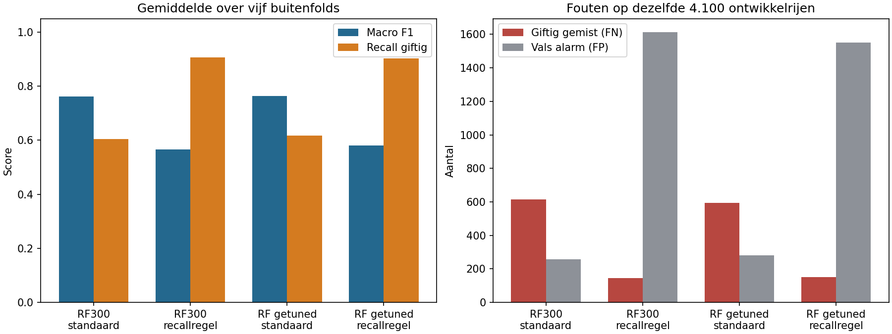

# Werkelijke uitkomst van het alternatief

Uitgevoerd op 15 oktober 2026. Bron, versies, zoekruimte en codehash staan in
[protocol.json](results/protocol.json). Dit is een vergelijking op de 4.100
historische trainingsrijen, met vijf buitenfolds en drie binnenfolds voor tuning.
De 900 bekende ontwikkeltestrecords zijn voor het alternatief niet gescoord.

| Procedure | Gem. macro F1 | Gem. recall giftig | Gemiste giftige records (FN) | Valse alarmen (FP) |
|---|---:|---:|---:|---:|
| Bestaande RF300, opnieuw gefit, standaardlabels | 0,761876 | 60,44% | 614 | 256 |
| Nieuw getunede RF150, standaardlabels | 0,762934 | 61,79% | 593 | 280 |
| Bestaande RF300, binnen training gekozen recallregel | 0,565217 | 90,66% | 145 | 1.613 |
| Nieuw getunede RF150, binnen training gekozen recallregel | 0,580791 | 90,33% | 150 | 1.551 |

De aantallen zijn opgeteld over de vijf buitenfolds: iedere rij wordt per
procedure precies eenmaal voorspeld zonder die rij mee te trainen. Scores zijn
het gemiddelde van de vijf foldmetrics. De gedetailleerde tabel bevat ook
precision, specificiteit, ROC-AUC, AP en spreiding over folds.

## Is het alternatief beter?

**De methode voor het beoordelen van nieuwe tuning is strikter; de gemeten
voorspellingswinst is klein.** Macro F1 stijgt met circa 0,00106, oftewel 0,106
procentpunt op een schaal van 0–100. Giftige recall stijgt met circa 1,35
procentpunt. Er zijn 21 minder FN, ten koste van 24 extra FP. Er is geen
onafhankelijke eindtest of aangetoonde statistische superioriteit.

De zoekkandidaat gebruikt 150 bomen en eenvoudige imputatie. De binnenfolds kozen
steeds `max_features=None`; vier keer een eigen missingcategorie en één keer
modus. Twee keer werd `min_samples_leaf=3` gekozen en drie keer `1`. Dit zijn
vijf foldspecifieke keuzes, geen hier geselecteerd nieuw definitief artifact.
Het experiment isoleert ook niet het effect van één imputatiekeuze: er worden
complete selectieprocedures vergeleken.

De recallregel laat vooral de prijs van minder gemiste giftige records zien.
Bij de getunede RF daalt FN van 593 naar 150, maar stijgt FP van 280 naar 1.551.
Macro F1 en het vermogen om eetbare records ongemoeid te laten nemen af. De 90%
was een demonstratiedoel in training; de buitenresultaten bewijzen geen veiligheid
op echte paddenstoelen en modelscores zijn niet als kansen gekalibreerd.

**Mijn advies:** neem de helderdere validatie, de nieuwe tuningregistratie en de
foutenafweging over als aanvullende onderbouwing. Vervang de huidige gehoste RF300
op basis van dit kleine verschil niet automatisch. De bestaande websitebeslissing
die geen eetbaarheid bevestigt, blijft een verstandige afbakening voor dit project.

## Wat de uitvoering wel en niet bewijst

- Er zijn 8 configuraties × 3 binnenfolds × 5 buitenfolds doorzocht, plus refits en
  aparte binnen-OOF voorspellingen voor de drempel. De [uitvoeringsreceipt](results/run.json)
  legt de werkelijke doorlooptijd en nul gescoorde ontwikkeltestrijen vast.
- Alle preprocessing leert binnen de betreffende trainingsfold. De drempel ziet
  geen labels uit de buitenvalidatie waarop hij wordt beoordeeld.
- De RF300-referentie reproduceert in deze nieuwe omgeving dezelfde gemiddelde
  CV macro F1 als de historische referentie. Beide procedures zijn hier opnieuw
  gefit met sklearn 1.6.1; er zijn geen 1.4.2-pickles als nieuwe fits voorgesteld.
- Dezelfde projectdata en modelideeën zijn eerder gebruikt. Ook deze buitenfolds
  zijn daardoor geen prospectieve, onafhankelijke eindtest. De vergelijking geeft
  ontwikkelbewijs, geen oplossing voor de oorspronkelijke testbesmetting.
- De rapportnotebooks lezen de nieuwe resultaten en zijn van boven naar beneden
  met Python uitgevoerd. Zij claimen geen tweede training of Jupyter-kernelrun.
- Er is geen model geëxporteerd voor hosting en er is niets op main gepubliceerd.
  De bestaande Final-, backend- en frontendbestanden zijn door dit concept niet gewijzigd.

## Controleerbare bestanden

[Foldmetrics](results/outer_fold_metrics.csv),
[samenvatting](results/summary.csv),
[buitenfoldvoorspellingen](results/outer_oof_predictions.csv),
[gekozen instellingen en drempels](results/selections.json).
De vijf `inner_search_fold_*.csv`-bestanden bevatten de echte grids en hun
train-/validatiescores. De geneste evaluatie legt niet opnieuw vast welk model
in productie moet; daarvoor is een afzonderlijk besluit met een nieuw
evaluatieprotocol nodig.
