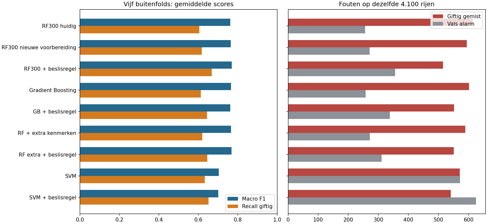

# Verdere verbetering: de gemeten uitkomst

Alle cijfers hieronder komen uit vijf buitenfolds op de 4.100 historische
trainingsrijen. De 900 bekende ontwikkeltestrecords zijn niet gescoord.
Dit blijft ontwikkelonderzoek op eerder gebruikte projectdata.

| Procedure | Macro F1 | Recall giftig | Precision giftig | FN | FP |
|---|---:|---:|---:|---:|---:|
| RF300 huidig | 0.7619 | 60.44% | 78.62% | 614 | 256 |
| RF300 nieuwe voorbereiding | 0.7646 | 61.73% | 77.92% | 594 | 271 |
| RF300 + beslisregel | 0.7691 | 66.82% | 74.49% | 515 | 356 |
| Gradient Boosting | 0.7650 | 61.21% | 78.64% | 602 | 258 |
| GB + beslisregel | 0.7619 | 64.44% | 74.94% | 552 | 338 |
| RF + extra kenmerken | 0.7659 | 62.05% | 77.93% | 589 | 272 |
| RF extra + beslisregel | 0.7686 | 64.50% | 76.34% | 551 | 311 |
| SVM | 0.7037 | 63.21% | 63.21% | 571 | 572 |
| SVM + beslisregel | 0.7008 | 65.14% | 61.86% | 541 | 625 |

## Wat verbetert daadwerkelijk?

De hoogste ontwikkelscore komt van **RF300 + beslisregel**: macro F1
**0.7691**, tegenover **0.7619** voor RF300.
De beperkte-integratievariant RF300 met de binnen training gekozen drempel haalt
**0.7691** en **66.82% giftige recall**.
Dat zijn **99 minder FN** en
**100 extra FP** op dezelfde 4.100 rijen.

De drempel hoort bij de **beslispolicy**. De oorspronkelijke ruwe classifierlabels
en modelscores blijven in de preview beschikbaar. Daarom worden raw-modelmetrics
en policy-metrics in het kandidaatmanifest strikt apart opgeslagen.

De beperkte-integratievariant haalt de vooraf beschreven ontwikkelcriteria: **ja**.
De vijf gepaarde macro-F1-verschillen zijn `[0.006395, -0.004799, 0.014205, 0.01194, 0.008503]`.
Deze criteria zijn geen significantietoets of onafhankelijke eindvalidatie.

Meer modelcomplexiteit wordt alleen aanbevolen als de daadwerkelijke winst de
extra voorbereiding en aangepaste inference rechtvaardigt. De totale accuracy
blijft hier ongeveer 78,8%; de winst zit in de andere afweging van fouttypen.
De uitgebreidere RF-voorbereiding en SVM leveren in deze studie geen reden
om hun extra complexiteit over te nemen. Een hoger maximum
na meer zoeken is op zichzelf onvoldoende bewijs.

## Wat staat klaar voor later?

- Een gewone RF300-pipeline zonder eigen serialisatieklassen en een verliesvrije
  array-export, gecontroleerd met de bestaande `PortableMushroom`.
- Een lokale preview die het huidige invoerschema en de echte API-controller
  hergebruikt. Alleen de voorgestelde beslisregel en bijpassende metadata worden
  in de conceptmap toegepast. De website bevestigt nog steeds geen eetbaarheid.
- [Integratie-instructies](INTEGRATIE.md) met de kleine wijzigingen die later
  samen moeten worden overgenomen, plus concrete uitvoeringscontroles.

## Grenzen

Er is geen algemene veiligheid of onaangeraakte eindtest aangetoond. De gridkeuzes
zijn binnen iedere training gemaakt; de totale tweede studie is wel geïnformeerd
door eerder projectonderzoek. Dat onderscheid blijft expliciet.

Verschillen tussen de families zijn verschillen tussen complete procedures.
Daarom schrijven we een verschil niet zonder aparte ablatietest volledig toe aan
één ratio, één imputatiemethode of één classifierinstelling.

[Protocol](results_v2/protocol.json), [foldmetrics](results_v2/outer_fold_metrics.csv),
[samenvatting](results_v2/summary.csv) en [besluit](results_v2/development_decision.json).

