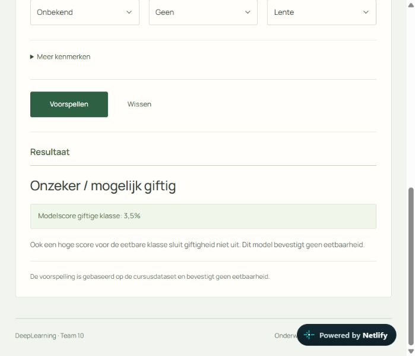
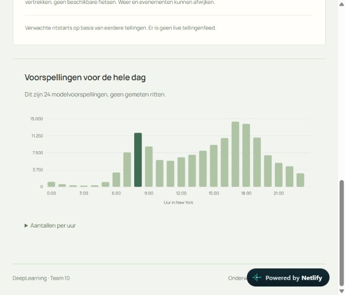

# Bewijs van de herhaalde Final-controle

Start met [het uitgevoerde controle-notebook](../11_Final_eindcontrole.ipynb)
of [de leesbare HTML-uitvoer](Final_eindcontrole.html).
De status en het echte eindtijdstip staan in [summary.json](summary.json).

Het [verse vergelijkingsnotebook](09_vergelijking_heruitgevoerd.ipynb)
bevat de opnieuw uitgevoerde code van `Final/Mushroom/09_vergelijking.ipynb`.
Alleen de relatieve Markdown-links zijn voor deze bewijsmap aangepast.
De oorspronkelijke Final-notebooks zijn tijdens de controle behouden.
Het [verse EDA-notebook met grafieken](01_EDA_heruitgevoerd.ipynb) is eveneens
opgenomen. De HTML-versies tonen de resultaten; de notebooks bewaren ook de code.

## Wat is opnieuw getest?

- Alle 19 Final-notebooks: schema, opgeslagen fouten, broncontrole en lokale links.
- De 12 notebooks uit `Final/tools/execute_notebooks.py`: opnieuw uitgevoerd,
  elk in een afzonderlijke Python 3.11-kernel. Dit omvat EDA, voorbereiding,
  vier vaste Mushroom-modellen, vergelijking en deploymentcontroles.
- De volledige bestaande Python-testset: 28 tests, met echte Mushroom- en
  Citi Bike-modelbestanden. Geen vervangend testmodel voor deze volledige run.
- De bestaande frontendtestset: 19 tests, plus vijf JavaScript-syntaxiscontroles.
- Gelijkheid van de actieve Mushroom-pipeline en serving-export op 5.000 rijen
  en de 900 bestaande referentievoorspellingen. Dit meet uitvoergelijkheid,
  geen nieuwe onafhankelijke modelprestatie.
- De publieke website en API: beide echte voorspelformulieren, 24 Citi Bike-
  uurvoorspellingen, CORS en dezelfde Mushroom-modelrevisie als lokaal.
- Bestandsvingerafdrukken voor 77 gevolgde Final-/runtimebestanden voor en na
  de controle. `protected_before.json` legt de geteste inhoud vast.

De zeven overige oorspronkelijke AWS-/Citi Bike-bronnotebooks behouden hun
bestaande studieresultaten. Er is geen nieuwe AWS-training, volledige
PyCaret-zoektocht of volledige oorspronkelijke Citi Bike-training uitgevoerd.
De publieke website is de bestaande hoofdversie; deze conceptbranch publiceert
geen nieuw model.

## Gevonden en hersteld

Een schone installatie van de notebookvereisten koos IPython 9.17.1.
Matplotlib 3.7.5 gebruikt nog `IPython.core.pylabtools.backend2gui`, waardoor
de eerste EDA-grafiek met een ImportError stopte. In
`Final/requirements-notebooks.txt` zijn daarom `ipython==8.37.0` en
`matplotlib-inline==0.1.7` vastgezet. Daarna is de volledige controle opnieuw
gestart. De trainings- en modelversies zijn daarbij behouden.

Een volgende Windows-run liep vast in de IPython-kernelcommunicatie
(`Timeout waiting for execute reply`, gevolgd door `ZMQError: not a socket`).
De notebookkernel is daarom vastgezet op `ipykernel==6.29.5`. De uiteindelijke
controle start opnieuw met deze kernel; alleen een volledige geslaagde run
verschijnt als geslaagd in het bewijsnotebook.

## Herhalen

Gebruik de volledige repository en Python 3.11 met
`Final/requirements-notebooks.txt` plus `nbconvert==7.16.6`.
De controlecode staat in `../final_validation.py`; de notebookgenerator in
`../build_final_validation.py`. Gebruik een afzonderlijke Python-omgeving voor
de API-tests met `backend/requirements.txt`, en een Node.js-installatie.
`FINAL_SERVING_PYTHON` en `FINAL_NODE` kunnen naar deze programma's verwijzen.
De hier gebruikte lokale omgevingen en gedownloade Citi Bike-gewichten staan
uitsluitend onder de genegeerde map `../.generated` en worden niet meegepusht.
De generator maakt de Jupyter-kernel `final-validation-311` zelf aan met de
Python waarmee hij gestart wordt. Deze wordt via `JUPYTER_PATH` onder
`.generated/final_validation/jupyter` gevonden.

Voer vanuit de repositoryroot met die Python 3.11-omgeving uit:

```text
python -B solutions/milan/build_final_validation.py
```

Dit overschrijft de bewijsbestanden met de nieuwe echte resultaten. Met
`--render-only` wordt uitsluitend de HTML-weergave van de bestaande uitvoer
vernieuwd; er worden dan geen tests herhaald.

## Browserbewijs

De screenshots tonen echte resultaten op de bestaande publieke website:




